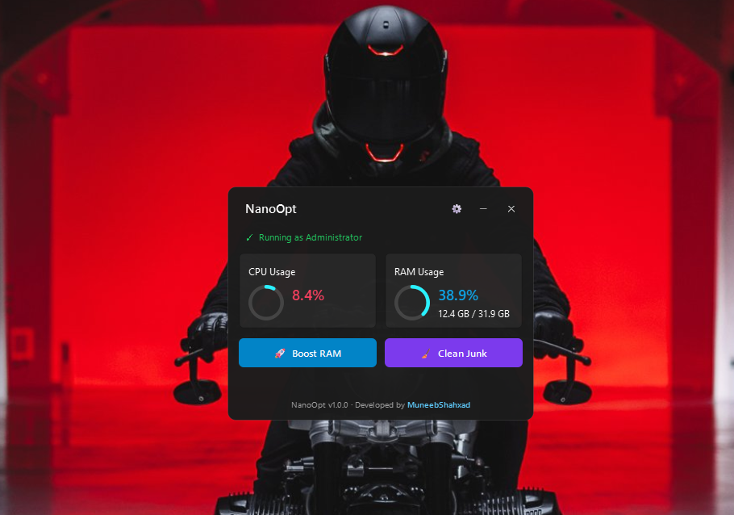

  

# 🚀 NanoOpt — High Performance Windows PC Optimizer

  
  
  
  

  <strong>Lightweight · Modern Fluent Design · Safe RAM Purge · 14-Target Junk Cleaner · Live Terminal · Auto-Optimizer</strong>

---

> **Notice:** NanoOpt is a **closed-source, proprietary application**. The source code is private and protected. Only official, pre-compiled standalone executables (`NanoOpt.exe`) are distributed for end-users.

---

## ✨ Features

- **🚀 Smart RAM Boost**: Instantly frees up memory with a single click while safely protecting running programs.
- **🧹 14-Target Deep Cleaner**: Safely finds and removes junk files from 14 Windows areas (Windows Update cache, prefetch, shader caches, crash dumps, and temp files).
- **🖥️ Live Activity Log Terminal**: Watch live step-by-step cleaning details right on your dashboard with color-coded feedback (easily toggle on/off in Settings).
- **🛡️ 100% Safe & Protected**: Your personal **Downloads** folder and **Recycle Bin** are strictly protected and never touched.
- **🎮 Game Mode Optimizer**: Automatically switches Windows to "High Performance" power mode and lowers background app priority when gaming.
- **⚡ Standby Memory Purge**: Clears Windows standby memory list before games start to eliminate in-game micro-stutters.
- **🎯 Game Watch List**: Automatically detects when your selected games launch and applies instant optimizations.
- **🌐 Optional Browser Cache Clean**: Choose whether to clean browser caches (Chrome, Edge, Firefox, Brave, Opera) via a simple toggle in Settings (turned **OFF** by default).
- **⚙️ Auto-Purge RAM**: Set your preferred RAM threshold (e.g. 85%) so NanoOpt automatically purges memory in the background when usage gets high.
- **🛡️ App & Directory Whitelist**: Add your favorite apps and folders to the exclusion list so they are never touched.
- **🪟 Run on Startup**: Seamlessly starts with Windows using Task Scheduler without annoying UAC prompts.
- **🔔 Desktop Notifications**: Displays helpful, silent desktop notifications when memory is recovered.
- **📊 Activity History & CSV Export**: Automatically logs all cleaning events with one-click export to CSV.
- **🔄 Instant Auto-Updates (OTA)**: Checks for new versions automatically and updates in one click.
- **🌙 Modern Windows 11 Design**: Clean, compact dark/light mode interface with real-time CPU and RAM monitoring rings.

---

## 📋 Changelog & Version History

See the complete feature log and release history across all versions in [**CHANGELOG.md**](CHANGELOG.md).

---

## 📥 Download & Usage

1. Head to the official [**Releases**](https://github.com/muneebshahxad/NanoOpt/releases) page.
2. Download the latest compiled binary (`NanoOpt.exe`).
3. Right-click and select **Run as Administrator** (required for deep system cache cleanup and memory management).
4. No installation or Python setup needed — it is a standalone portable application.

---

## 📜 License

Copyright (c) 2026 MuneebShahxad. All Rights Reserved.  
This software is proprietary. Unauthorized copying, modification, or distribution is strictly prohibited.  
See the [LICENSE](LICENSE) file for legal terms.

---

## 👤 Author
Developed by **[MuneebShahxad](https://github.com/muneebshahxad)**
